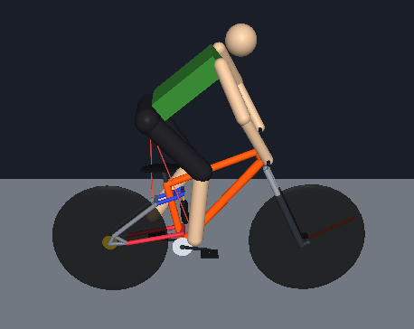
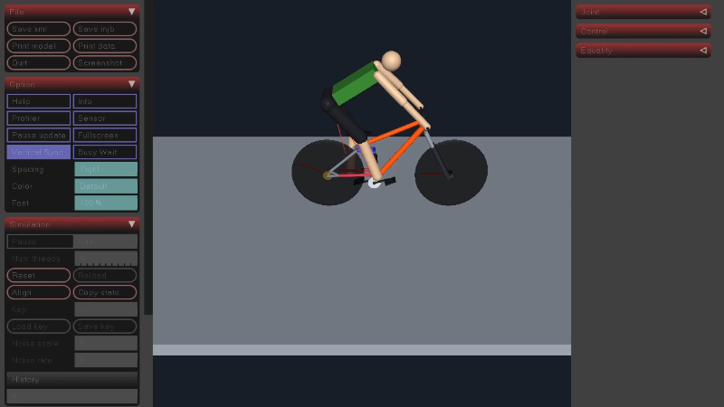
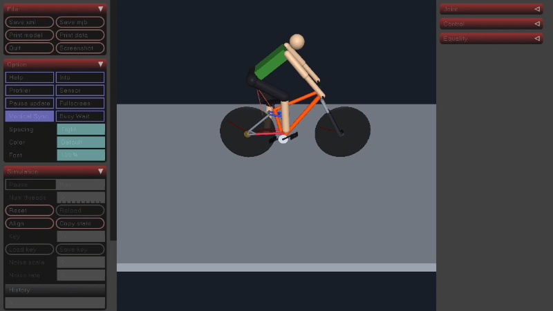

  



# MuJoCo Mountain-Bike Simulation

  

  

This project is a planar mountain-bike simulation built with [MuJoCo](https://mujoco.org/). It models full-suspension bikes with geometries representative of generic mountain bikes. Two rear-suspension layouts are currently implemented: a single-pivot design and a four-link design with a rocker-driven shock. A freehub controller ensures that crank torque is transmitted through the chain in only one direction.

  

  

The rider is a simplified articulated model inspired by the publications [10.1115/1.2796088](https://doi.org/10.1115/1.2796088) and [10.1007/978-3-319-09858-6_13](https://doi.org/10.1007/978-3-319-09858-6_13). The model supports both passive spring-damper behavior and active joint torque control.

  

  

## Rear-suspension analysis

  

  

Run `rear_suspension_analysis.py` from the project root to compare the two suspension layouts through their travel:

  

  

```bash

  

python  rear_suspension_analysis.py

  

```

  

  

The analysis disconnects the rider, fixes the main frame, and sweeps the rear shock through its travel. It shows the rear axle path and pedal rotation. Chain growth is represented by the change in distance between the bottom bracket and rear axle as the suspension moves; other drivetrain effects are outside the scope of this analysis.

  

  

## Dynamic simulation with a passive rider

  

  

Run `simulate_passive_rider.py` from the project root to launch an interactive simulation:

  

  

```bash

  

python  simulate_passive_rider.py

  

```

  

  

The mountain bike is towed over terrain to maintain a target forward speed. The rider is connected to the bike, and passive spring-damper elements at the rider's joints model the rider's response. The example script configures a rectangular bump; terrain and tow settings can be adjusted in the script.

  

  

## Dynamic simulation with optimized rider behaviour

  

  

The learning environment allows the rider to actively produce joint torques. A reinforcement-learning controller is trained with Proximal Policy Optimization (PPO), enabling it to learn task-specific behavior.

For the manual task, the controller learns to balance on the rear wheel:



For the obstacle task, the controller learns to ride over obstacles:



  

  

Train a policy from the project root with:

  

  

```bash

  

python  -m  learning.train  --task  manual

  

```

  

  

For the obstacle task, use:

  

  

```bash

  

python  -m  learning.train  --task  obstacle

  

```

  

  

Training runs and saved policies are stored under `learning/logs/ppo_mtb/` and `learning/models/ppo_mtb/` by default. To render an episode with the most recent saved policy, run:

  

  

```bash

  

python  -m  learning.enjoy

  

```

  

  

## Project layout

  

  

-  `mtb_model/model_single_pivot.xml` and `mtb_model/model_four_link.xml` are the MuJoCo model entry points.

  

-  `mtb_model/components/`, `mtb_model/suspension/`, and `mtb_model/systems/` contain reusable bike, suspension, rider, drivetrain, actuator, and sensor definitions.

  

-  `rear_suspension_analysis.py` runs the kinematic suspension sweep.

  

-  `simulate_passive_rider.py` runs the interactive simulation where the bike is towed and the rider is passive.

  

-  `simulation/` and `controllers/` provide simulation utilities and bike controllers.

  

-  `learning/` contains the Gymnasium environment, PPO training, and policy playback code.